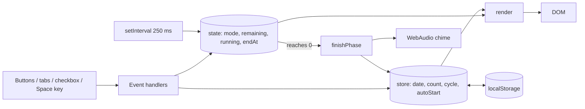

# Design: Haunted Pomodoro Timer

## Overview

A static page made of three files in `halloween-pomodoro/`. There is no framework and no build step. State lives in two plain objects in `app.js`, and one `render()` function writes it to the DOM.

```
halloween-pomodoro/
  index.html   markup + inline SVG art
  style.css    theme variables, layout, animations, mobile rules
  app.js       timer, persistence, rendering, sound, events
  README.md
```

## Architecture



## Components

### Timer (`app.js`)

- `DURATIONS = { focus: 1500, short: 300, long: 900 }` in seconds.
- `state`: `mode`, `remaining` (seconds), `running`, `endAt` (epoch ms), `intervalId`, `notice`.
- `startTicking()` sets `endAt = Date.now() + remaining * 1000` and starts a 250 ms interval.
- `tick()` recomputes `remaining = max(0, (endAt - Date.now()) / 1000)`. Computing from a timestamp keeps the countdown correct when the browser throttles timers. A `visibilitychange` listener calls `tick()` when the tab becomes visible.
- `pause()` calls `tick()` first so `remaining` is current, then stops the interval.
- `switchMode(mode, { autoRun })` stops, loads the new duration and optionally starts.
- `finishPhase()` is the single place where phases end.

### Phase transition rules

| Finished | Condition | Next |
|---|---|---|
| Focus | `cycle` after increment < 4 | Short Break |
| Focus | `cycle` after increment = 4 (then `cycle = 0`) | Long Break |
| Short Break or Long Break | any | Focus |

Next phase starts running only when `store.autoStart` is true. A notice string is stored in `state.notice` and shown in place of the normal label until the user next acts.

### Persistence

Key `haunted-pomodoro-v1`, value:

```json
{ "date": "2026-11-21", "count": 4, "cycle": 0, "autoStart": true }
```

- `count`: rounds completed today. `cycle`: rounds completed in the current set (0 to 3).
- `loadStore()` validates and clamps values and returns defaults on parse errors. If `date` is not today, `count` and `cycle` are zero. `autoStart` is kept.
- `rollDayIfNeeded()` runs on start and phase end so a page left open past midnight rolls over.
- `saveStore()` swallows storage errors.
- A `storage` event listener reloads the store when another tab writes.

### Rendering

- `render()` updates body `data-mode` and `running` class, tab selection, button label, counters and checkbox, then calls `renderTime()`, `renderLabel()` and `renderRounds()`.
- `renderTime()` runs on each tick. It updates the time text, the ring `stroke-dashoffset` (`circumference * (1 - remaining / total)`) and `document.title`.
- `renderRounds()` reuses four dot elements and only changes their classes.
- `animate(el, class)` restarts a CSS animation by removing the class, forcing reflow and re-adding it.

### Sound

`ensureAudio()` creates the `AudioContext` on the first Start click, which satisfies browser autoplay rules. `playChime()` plays three descending triangle-wave notes (523.25, 392.00, 311.13 Hz). If audio is unavailable the app stays silent.

## Theming

`style.css` defines mode colors as CSS custom properties on `body`:

| Variable | Purpose |
|---|---|
| `--orange`, `--orange-hot` | accent and highlight (named for the default scheme; value changes per mode) |
| `--pk-a`, `--pk-b` | pumpkin gradient stops |
| `--pk-side`, `--pk-mid` | pumpkin lobes |
| `--pk-stem` | stem stroke |
| `--pk-glow` | lit face color |
| `--pk-shadow` | pumpkin drop-shadow color |

| Mode | Accent | Pumpkin body | Stem |
|---|---|---|---|
| Focus | `#ff8a1f` orange | orange | dark green |
| Short Break | `#a78bfa` purple | purple | dark green |
| Long Break | `#4ade80` green | green | pale lime `#d9f99d` for contrast against the green body |

The pumpkin SVG uses classes (`pk-a`, `pk-b`, `pk-side`, `pk-mid`, `pk-stem`) and CSS properties for its colors, not fixed fill attributes. A `hue-rotate` filter was tried first and rejected: it turned the stem teal or pink and gave the short-break pumpkin a magenta tint that did not match the purple accent.

## Layout and responsiveness

- `.app` is a centered flex column, max width 460px.
- The dial is `min(320px, 80vw)` wide and square. At 600px and below it becomes `min(230px, 62vw)` and spacing, title size and timer font shrink so the controls and stat cards fit in a 390×760 viewport.
- Fixed decorations (moon, stars, fog, ghosts, bats, graveyard) have `pointer-events: none` and sit under `.app` (`z-index: 2`).
- `.ring { overflow: visible }` prevents the ring's glow from being clipped to a square.
- On narrow screens one ghost is hidden and the other sits at the bottom edge, below the stat cards.

## Animations

| Name | Target | Purpose |
|---|---|---|
| `rise` | `.app` | fade in on load |
| `float`, `fly`, `flap` | ghosts, bats | ambient motion |
| `drift` | fog layers | slow horizontal drift |
| `bob`, `flicker` | pumpkin | idle bob, running flicker |
| `ringglow` | ring | pulse while running |
| `shake` | pumpkin | phase end |
| `bump` | today's count | round completed |
| `pulse` | current dot | marks active round |

`@media (prefers-reduced-motion: reduce)` disables all animation and transitions.

## Accessibility

- Mode tabs use `role="tab"` and `aria-selected`. The time uses `role="timer"`.
- All decorative SVGs have `aria-hidden="true"`.
- Buttons and the checkbox are keyboard focusable, with a visible focus outline on buttons and tabs.

## Error handling

| Failure | Behavior |
|---|---|
| Corrupt or missing saved data | defaults |
| `localStorage` blocked or full | works in memory, no error shown |
| No WebAudio | silent phase change |
| Throttled background tab | countdown stays correct, display catches up on next tick |

## Testing approach

Browser checks with Playwright and a fake clock (`page.clock`): run each phase to completion in seconds and assert the displayed time, mode, button label, round text and today's count after each step. Reload and assert persistence. Screenshots at 375×667, 390×760 and 1100×800 for layout and color. Not covered: audio output and non-Chromium browsers.
